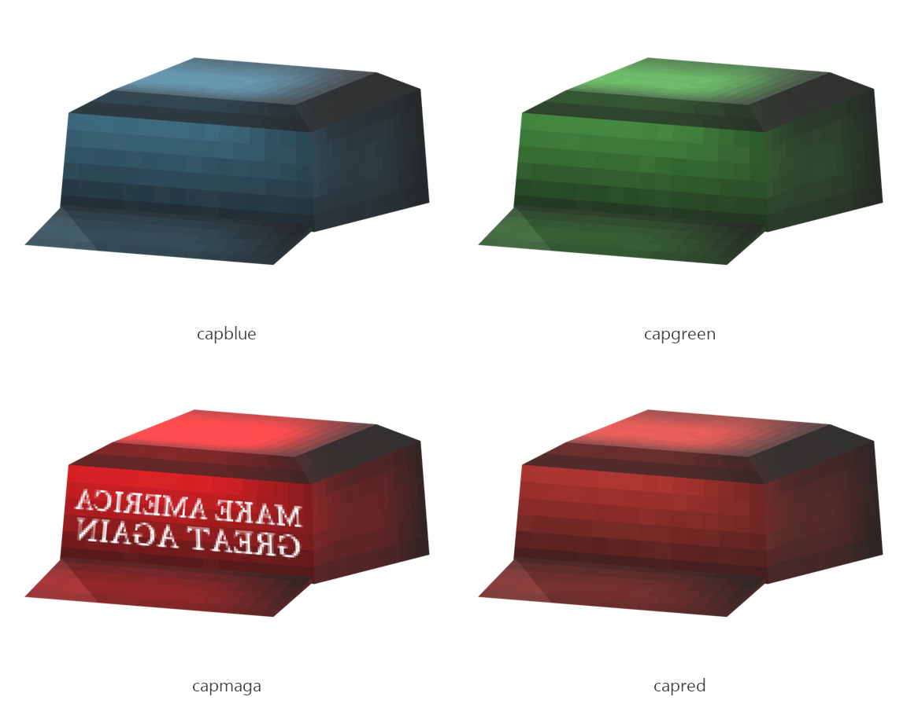

# Cap

Board ticket `t002` | category `armor` | 4 variants

## Variants to replace

- `capblue`
- `capgreen`
- `capmaga`
- `capred`

Each variant in `old/` has its own `models/` and `textures/`. Deliver one replacement per variant in `new/`, using the same variant names unless agreed otherwise.

## Where the old asset lives in the mod

- `content/armor/full/capblue`
- `content/armor/full/capgreen`
- `content/armor/full/capmaga`
- `content/armor/full/capred`

## Status

Not started