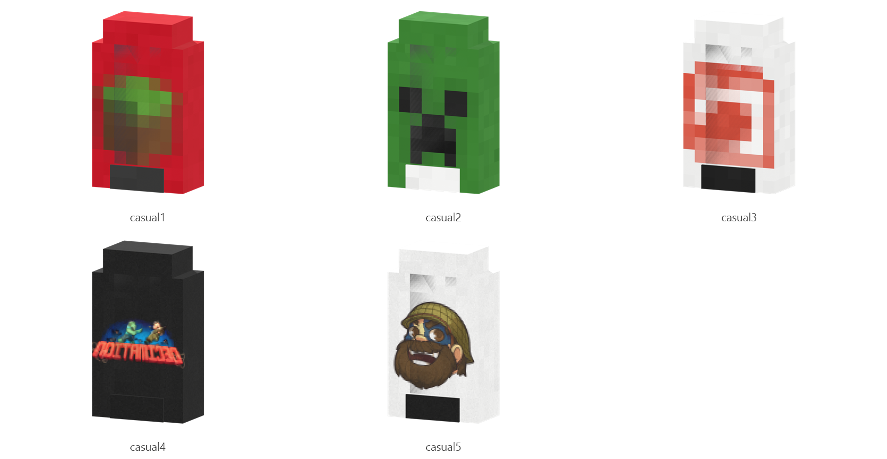

# Casual

Board ticket `t003` | category `armor` | 5 variants

## Variants to replace

- `casual1`
- `casual2`
- `casual3`
- `casual4`
- `casual5`

Each variant in `old/` has its own `models/` and `textures/`. Deliver one replacement per variant in `new/`, using the same variant names unless agreed otherwise.

## Where the old asset lives in the mod

- `content/armor/full/casual1`
- `content/armor/full/casual2`
- `content/armor/full/casual3`
- `content/armor/full/casual4`
- `content/armor/full/casual5`

## Status

Not started