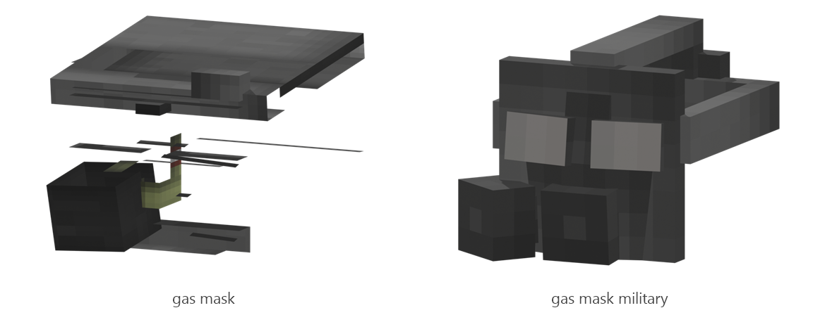

# Gas mask

Board ticket `t017` | category `armor` | 2 variants

## Variants to replace

- `gas_mask`
- `gas_mask_military`

Each variant in `old/` has its own `models/` and `textures/`. Deliver one replacement per variant in `new/`, using the same variant names unless agreed otherwise.

## Where the old asset lives in the mod

- `content/armor/mask/gas_mask`
- `content/armor/mask/gas_mask_military`

## Status

Not started