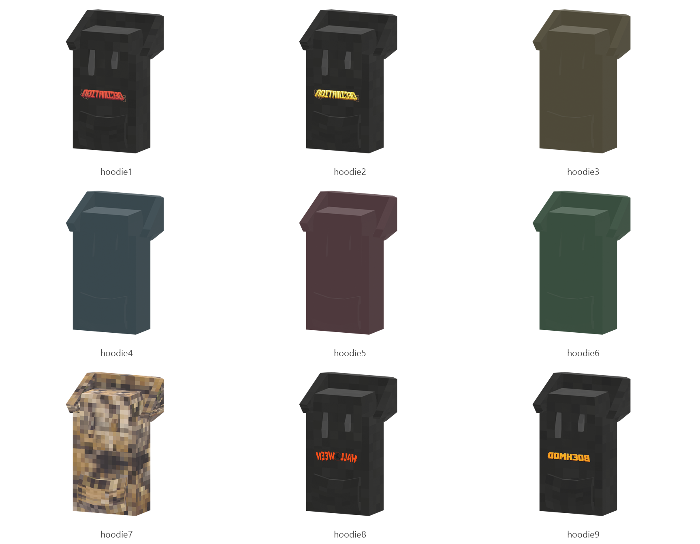

# Hoodie

Board ticket `t006` | category `armor` | 9 variants

## Variants to replace

- `hoodie1`
- `hoodie2`
- `hoodie3`
- `hoodie4`
- `hoodie5`
- `hoodie6`
- `hoodie7`
- `hoodie8`
- `hoodie9`

Each variant in `old/` has its own `models/` and `textures/`. Deliver one replacement per variant in `new/`, using the same variant names unless agreed otherwise.

## Where the old asset lives in the mod

- `content/armor/full/hoodie1`
- `content/armor/full/hoodie2`
- `content/armor/full/hoodie3`
- `content/armor/full/hoodie4`
- `content/armor/full/hoodie5`
- `content/armor/full/hoodie6`
- `content/armor/full/hoodie7`
- `content/armor/full/hoodie8`
- `content/armor/full/hoodie9`

## Status

Not started