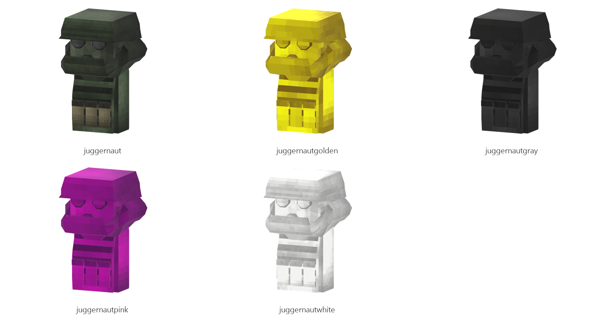

# Juggernaut

Board ticket `t007` | category `armor` | 5 variants

## Variants to replace

- `juggernaut`
- `juggernautgolden`
- `juggernautgray`
- `juggernautpink`
- `juggernautwhite`

Each variant in `old/` has its own `models/` and `textures/`. Deliver one replacement per variant in `new/`, using the same variant names unless agreed otherwise.

## Where the old asset lives in the mod

- `content/armor/full/juggernaut`
- `content/armor/full/juggernautgolden`
- `content/armor/full/juggernautgray`
- `content/armor/full/juggernautpink`
- `content/armor/full/juggernautwhite`

## Status

Not started