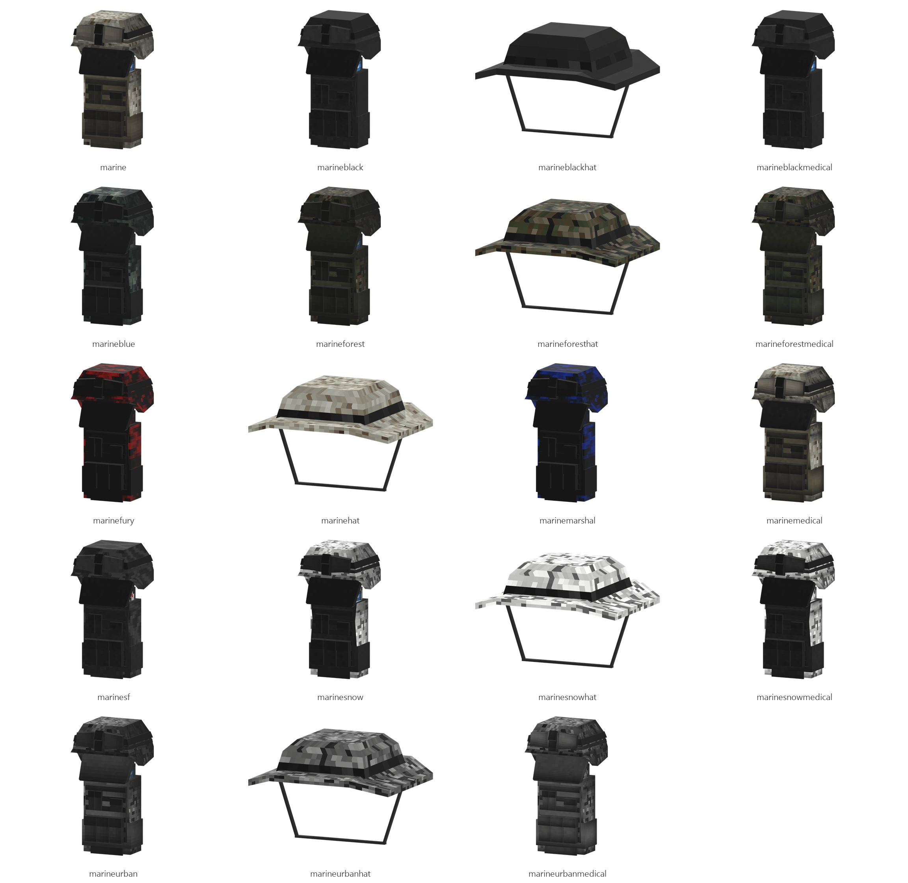

# Marine

Board ticket `t008` | category `armor` | 19 variants

## Variants to replace

- `marine`
- `marineblack`
- `marineblackhat`
- `marineblackmedical`
- `marineblue`
- `marineforest`
- `marineforesthat`
- `marineforestmedical`
- `marinefury`
- `marinehat`
- `marinemarshal`
- `marinemedical`
- `marinesf`
- `marinesnow`
- `marinesnowhat`
- `marinesnowmedical`
- `marineurban`
- `marineurbanhat`
- `marineurbanmedical`

Each variant in `old/` has its own `models/` and `textures/`. Deliver one replacement per variant in `new/`, using the same variant names unless agreed otherwise.

## Where the old asset lives in the mod

- `content/armor/full/marine`
- `content/armor/full/marineblack`
- `content/armor/full/marineblackhat`
- `content/armor/full/marineblackmedical`
- `content/armor/full/marineblue`
- `content/armor/full/marineforest`
- `content/armor/full/marineforesthat`
- `content/armor/full/marineforestmedical`
- `content/armor/full/marinefury`
- `content/armor/full/marinehat`
- `content/armor/full/marinemarshal`
- `content/armor/full/marinemedical`
- `content/armor/full/marinesf`
- `content/armor/full/marinesnow`
- `content/armor/full/marinesnowhat`
- `content/armor/full/marinesnowmedical`
- `content/armor/full/marineurban`
- `content/armor/full/marineurbanhat`
- `content/armor/full/marineurbanmedical`

## Status

Not started