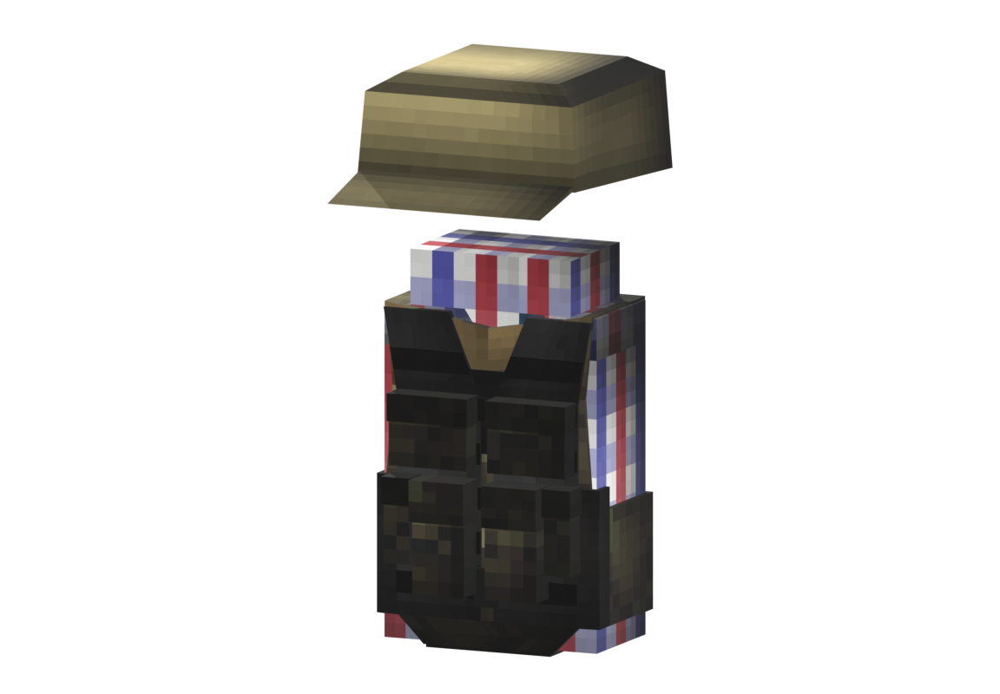

# Militia

Board ticket `t009` | category `armor` | 1 variant

## Variants to replace

- `militia`

Each variant in `old/` has its own `models/` and `textures/`. Deliver one replacement per variant in `new/`, using the same variant names unless agreed otherwise.

## Where the old asset lives in the mod

- `content/armor/full/militia`

## Status

Not started