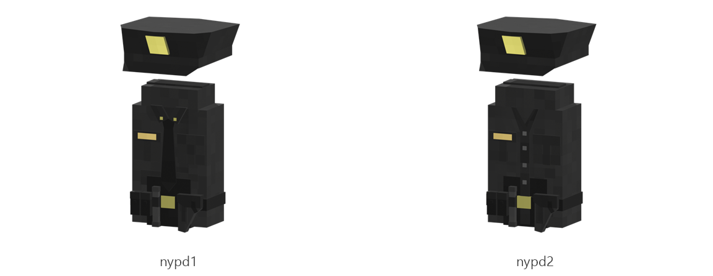

# NYPD

Board ticket `t010` | category `armor` | 2 variants

## Variants to replace

- `nypd1`
- `nypd2`

Each variant in `old/` has its own `models/` and `textures/`. Deliver one replacement per variant in `new/`, using the same variant names unless agreed otherwise.

## Where the old asset lives in the mod

- `content/armor/full/nypd1`
- `content/armor/full/nypd2`

## Status

Not started