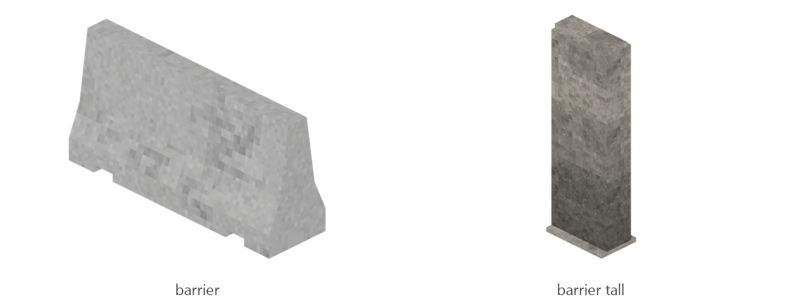

# Barrier

Board ticket `t068` | category `block` | 2 variants

## Variants to replace

- `barrier`
- `barrier_tall`

Each variant in `old/` has its own `models/` and `textures/`. Deliver one replacement per variant in `new/`, using the same variant names unless agreed otherwise.

## Where the old asset lives in the mod

- `content/block/decimation/barrier`
- `content/block/decimation/barrier_tall`

## Status

Not started