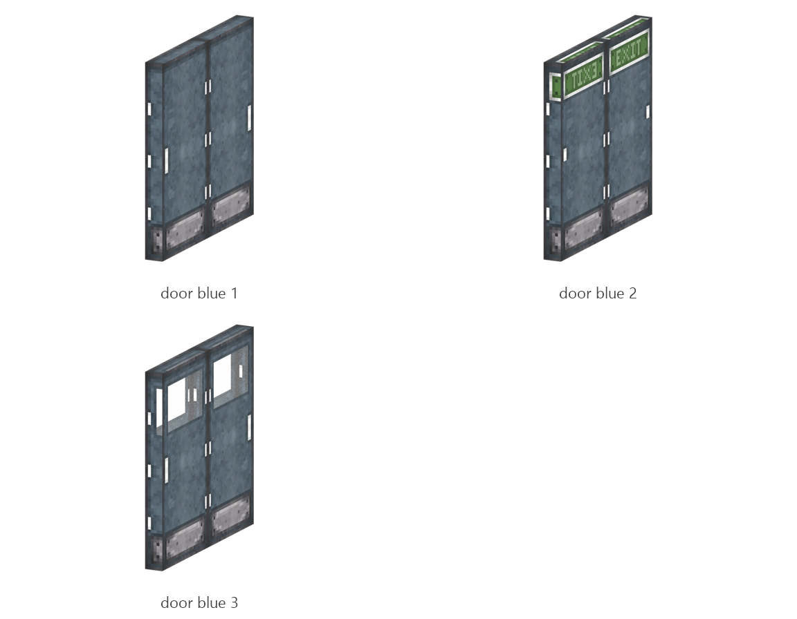

# Blue door

Board ticket `t080` | category `block` | 3 variants

## Variants to replace

- `door_blue_1`
- `door_blue_2`
- `door_blue_3`

Each variant in `old/` has its own `models/` and `textures/`. Deliver one replacement per variant in `new/`, using the same variant names unless agreed otherwise.

## Where the old asset lives in the mod

- `content/block/decimation/door_blue_1`
- `content/block/decimation/door_blue_2`
- `content/block/decimation/door_blue_3`

## Status

Not started