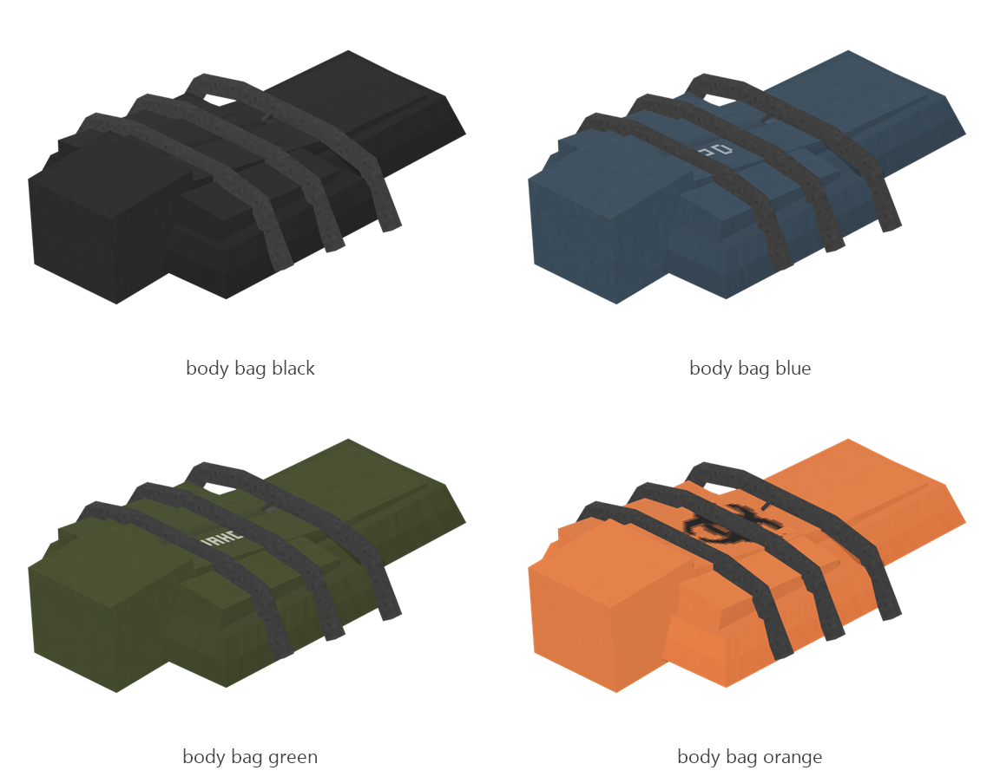

# Body bag

Board ticket `t070` | category `block` | 4 variants

## Variants to replace

- `body_bag_black`
- `body_bag_blue`
- `body_bag_green`
- `body_bag_orange`

Each variant in `old/` has its own `models/` and `textures/`. Deliver one replacement per variant in `new/`, using the same variant names unless agreed otherwise.

## Where the old asset lives in the mod

- `content/block/decimation/body_bag_black`
- `content/block/decimation/body_bag_blue`
- `content/block/decimation/body_bag_green`
- `content/block/decimation/body_bag_orange`

## Status

Not started