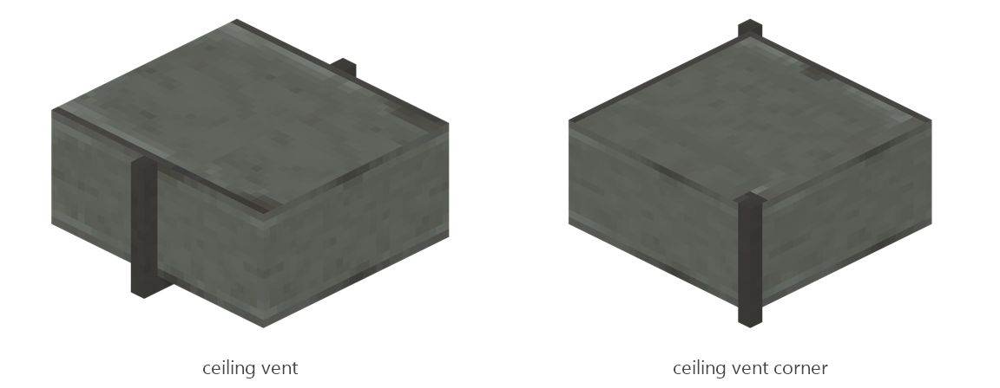

# Ceiling vent

Board ticket `t075` | category `block` | 2 variants

## Variants to replace

- `ceiling_vent`
- `ceiling_vent_corner`

Each variant in `old/` has its own `models/` and `textures/`. Deliver one replacement per variant in `new/`, using the same variant names unless agreed otherwise.

## Where the old asset lives in the mod

- `content/block/decimation/ceiling_vent`
- `content/block/decimation/ceiling_vent_corner`

## Status

Not started