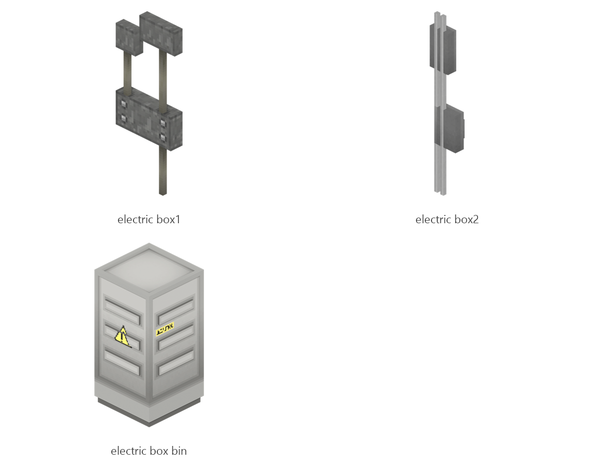

# Electric box

Board ticket `t089` | category `block` | 3 variants

## Variants to replace

- `electric_box1`
- `electric_box2`
- `electric_box_bin`

Each variant in `old/` has its own `models/` and `textures/`. Deliver one replacement per variant in `new/`, using the same variant names unless agreed otherwise.

## Where the old asset lives in the mod

- `content/block/decimation/electric_box1`
- `content/block/decimation/electric_box2`
- `content/block/decimation/electric_box_bin`

## Status

Not started