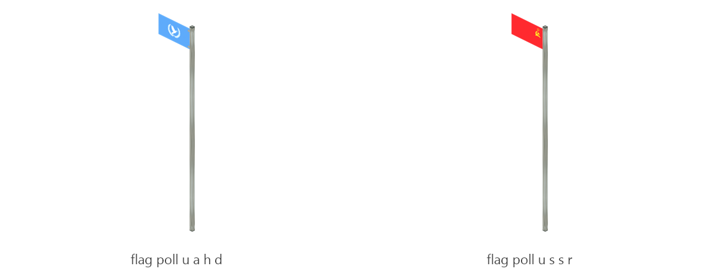

# Flag pole

Board ticket `t090` | category `block` | 2 variants

## Variants to replace

- `flag_poll_u_a_h_d`
- `flag_poll_u_s_s_r`

Each variant in `old/` has its own `models/` and `textures/`. Deliver one replacement per variant in `new/`, using the same variant names unless agreed otherwise.

## Where the old asset lives in the mod

- `content/block/decimation/flag_poll_u_a_h_d`
- `content/block/decimation/flag_poll_u_s_s_r`

## Status

Not started