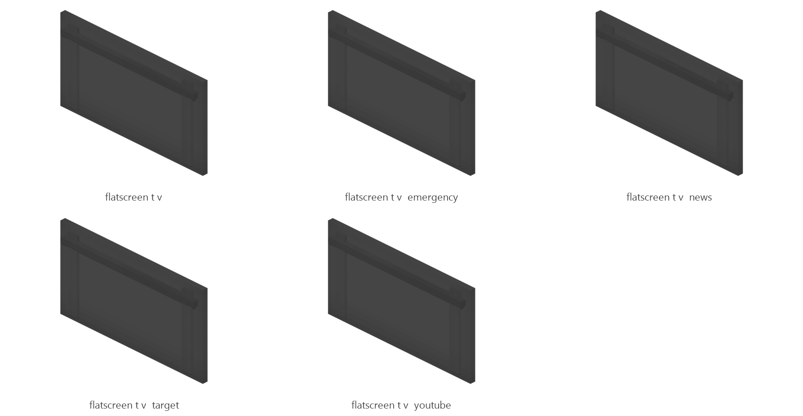

# Flatscreen TV

Board ticket `t091` | category `block` | 5 variants

## Variants to replace

- `flatscreen_t_v`
- `flatscreen_t_v__emergency`
- `flatscreen_t_v__news`
- `flatscreen_t_v__target`
- `flatscreen_t_v__youtube`

Each variant in `old/` has its own `models/` and `textures/`. Deliver one replacement per variant in `new/`, using the same variant names unless agreed otherwise.

## Where the old asset lives in the mod

- `content/block/decimation/flatscreen_t_v`
- `content/block/decimation/flatscreen_t_v__emergency`
- `content/block/decimation/flatscreen_t_v__news`
- `content/block/decimation/flatscreen_t_v__target`
- `content/block/decimation/flatscreen_t_v__youtube`

## Status

Not started