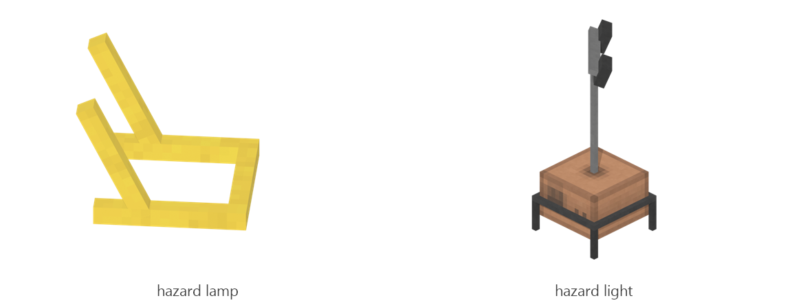

# Hazard lights

Board ticket `t092` | category `block` | 2 variants

## Variants to replace

- `hazard_lamp`
- `hazard_light`

Each variant in `old/` has its own `models/` and `textures/`. Deliver one replacement per variant in `new/`, using the same variant names unless agreed otherwise.

## Where the old asset lives in the mod

- `content/block/decimation/hazard_lamp`
- `content/block/decimation/hazard_light`

## Status

Not started