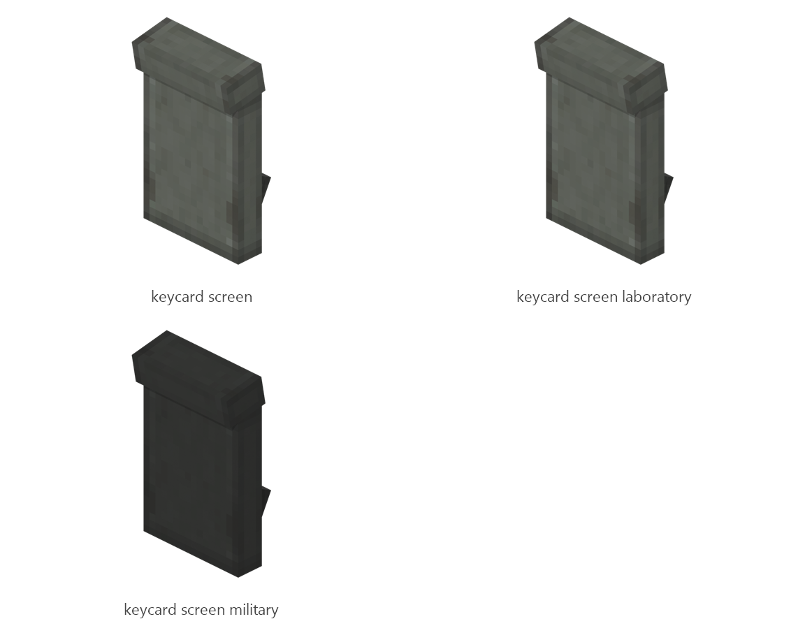

# Keycard screen

Board ticket `t096` | category `block` | 3 variants

## Variants to replace

- `keycard_screen`
- `keycard_screen_laboratory`
- `keycard_screen_military`

Each variant in `old/` has its own `models/` and `textures/`. Deliver one replacement per variant in `new/`, using the same variant names unless agreed otherwise.

## Where the old asset lives in the mod

- `content/block/decimation/keycard_screen`
- `content/block/decimation/keycard_screen_laboratory`
- `content/block/decimation/keycard_screen_military`

## Status

Not started