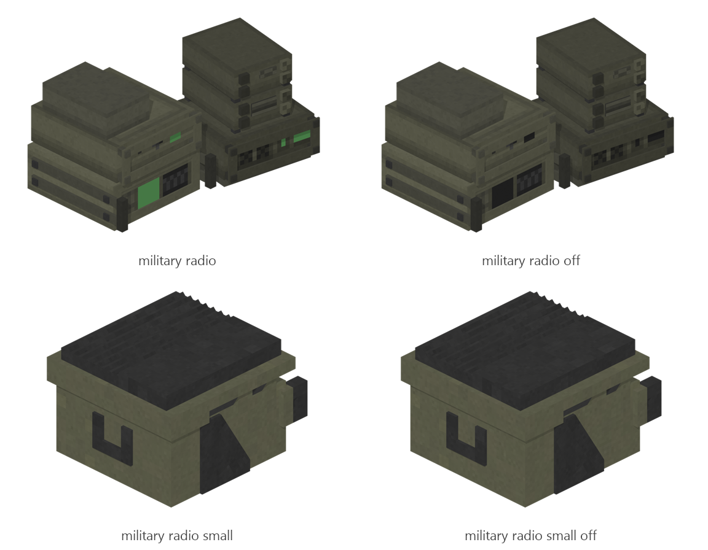

# Military radio

Board ticket `t106` | category `block` | 4 variants

## Variants to replace

- `military_radio`
- `military_radio_off`
- `military_radio_small`
- `military_radio_small_off`

Each variant in `old/` has its own `models/` and `textures/`. Deliver one replacement per variant in `new/`, using the same variant names unless agreed otherwise.

## Where the old asset lives in the mod

- `content/block/decimation/military_radio`
- `content/block/decimation/military_radio_off`
- `content/block/decimation/military_radio_small`
- `content/block/decimation/military_radio_small_off`

## Status

Not started