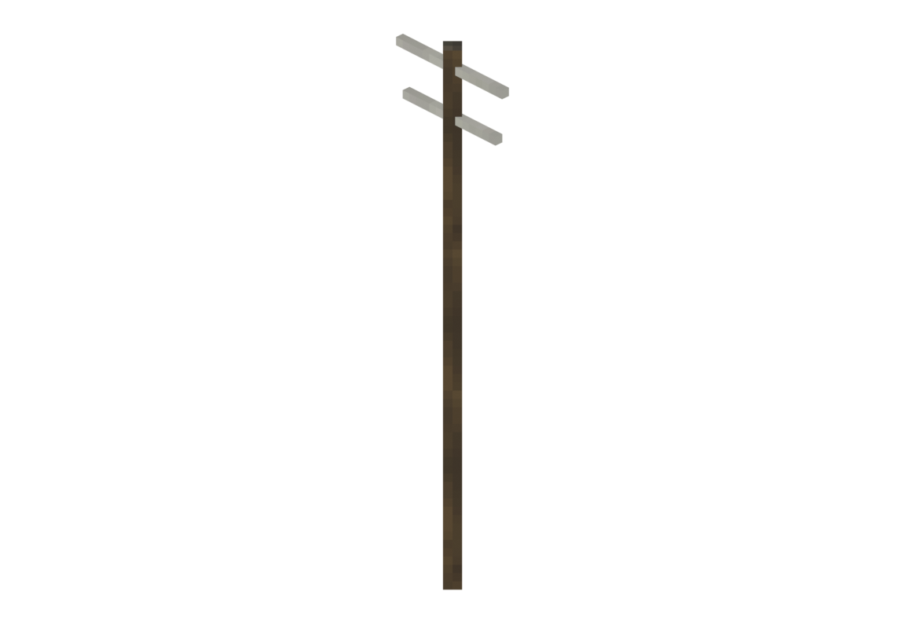

# Power pole

Board ticket `t114` | category `block` | 1 variant

## Variants to replace

- `power_pole`

Each variant in `old/` has its own `models/` and `textures/`. Deliver one replacement per variant in `new/`, using the same variant names unless agreed otherwise.

## Where the old asset lives in the mod

- `content/block/decimation/power_pole`

## Status

Not started