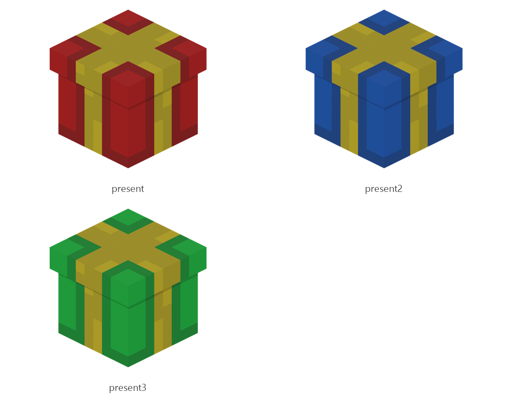

# Present

Board ticket `t115` | category `block` | 3 variants

## Variants to replace

- `present`
- `present2`
- `present3`

Each variant in `old/` has its own `models/` and `textures/`. Deliver one replacement per variant in `new/`, using the same variant names unless agreed otherwise.

## Where the old asset lives in the mod

- `content/block/decimation/present`
- `content/block/decimation/present2`
- `content/block/decimation/present3`

## Status

Not started