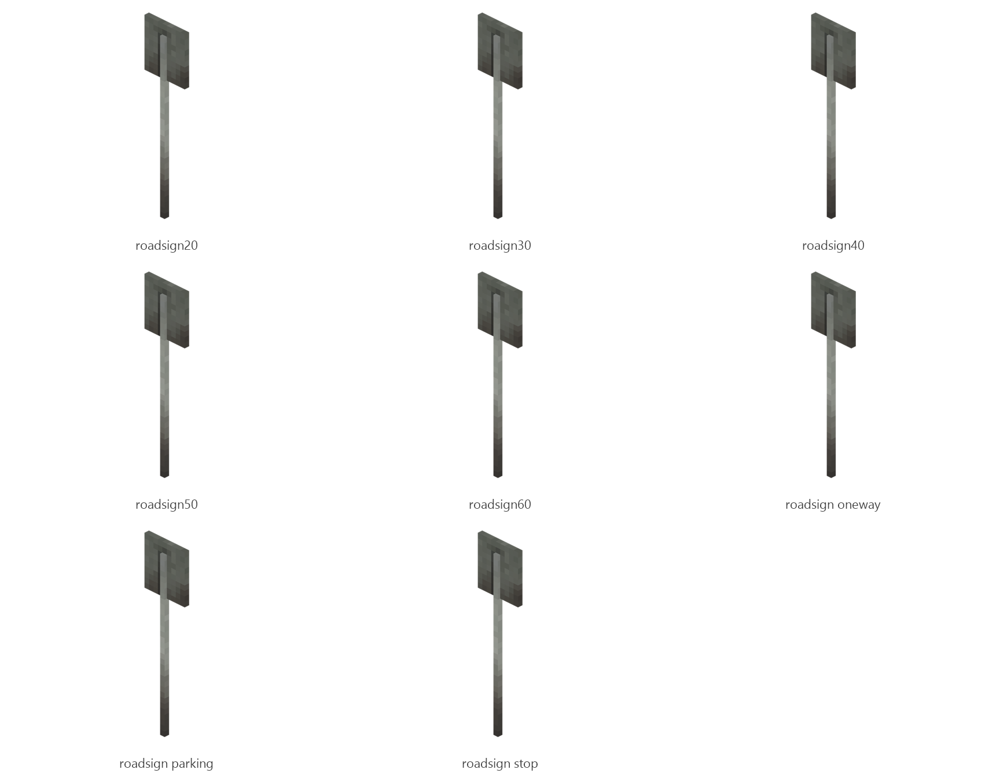

# Road sign

Board ticket `t119` | category `block` | 8 variants

## Variants to replace

- `roadsign20`
- `roadsign30`
- `roadsign40`
- `roadsign50`
- `roadsign60`
- `roadsign_oneway`
- `roadsign_parking`
- `roadsign_stop`

Each variant in `old/` has its own `models/` and `textures/`. Deliver one replacement per variant in `new/`, using the same variant names unless agreed otherwise.

## Where the old asset lives in the mod

- `content/block/decimation/roadsign20`
- `content/block/decimation/roadsign30`
- `content/block/decimation/roadsign40`
- `content/block/decimation/roadsign50`
- `content/block/decimation/roadsign60`
- `content/block/decimation/roadsign_oneway`
- `content/block/decimation/roadsign_parking`
- `content/block/decimation/roadsign_stop`

## Status

Not started