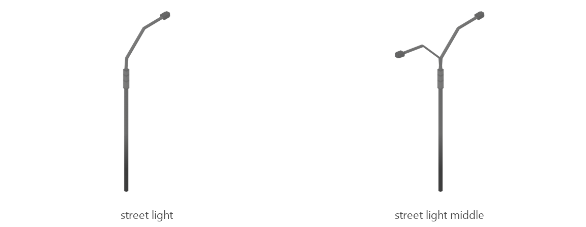

# Street light

Board ticket `t127` | category `block` | 2 variants

## Variants to replace

- `street_light`
- `street_light_middle`

Each variant in `old/` has its own `models/` and `textures/`. Deliver one replacement per variant in `new/`, using the same variant names unless agreed otherwise.

## Where the old asset lives in the mod

- `content/block/decimation/street_light`
- `content/block/decimation/street_light_middle`

## Status

Not started