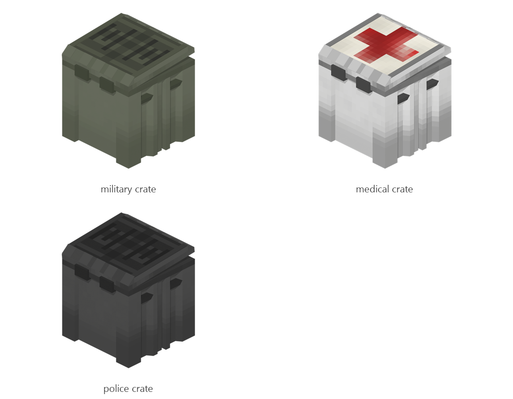

# Supply crate

Board ticket `t101` | category `block` | 3 variants

## Variants to replace

- `military_crate`
- `medical_crate`
- `police_crate`

Each variant in `old/` has its own `models/` and `textures/`. Deliver one replacement per variant in `new/`, using the same variant names unless agreed otherwise.

## Where the old asset lives in the mod

- `content/block/decimation/military_crate`
- `content/block/decimation/medical_crate`
- `content/block/decimation/police_crate`

## Status

Not started