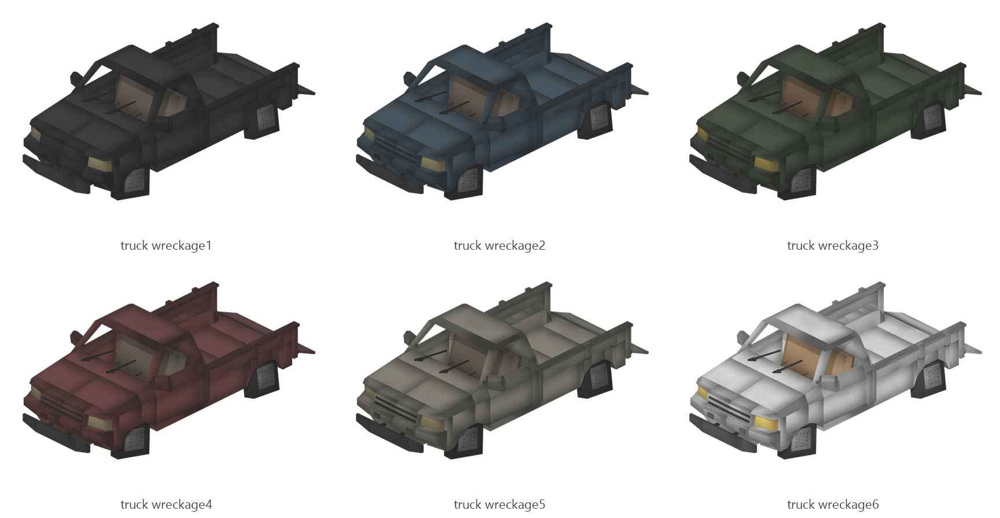

# Truck wreckage

Board ticket `t136` | category `block` | 6 variants

## Variants to replace

- `truck_wreckage1`
- `truck_wreckage2`
- `truck_wreckage3`
- `truck_wreckage4`
- `truck_wreckage5`
- `truck_wreckage6`

Each variant in `old/` has its own `models/` and `textures/`. Deliver one replacement per variant in `new/`, using the same variant names unless agreed otherwise.

## Where the old asset lives in the mod

- `content/block/decimation/truck_wreckage1`
- `content/block/decimation/truck_wreckage2`
- `content/block/decimation/truck_wreckage3`
- `content/block/decimation/truck_wreckage4`
- `content/block/decimation/truck_wreckage5`
- `content/block/decimation/truck_wreckage6`

## Status

Not started