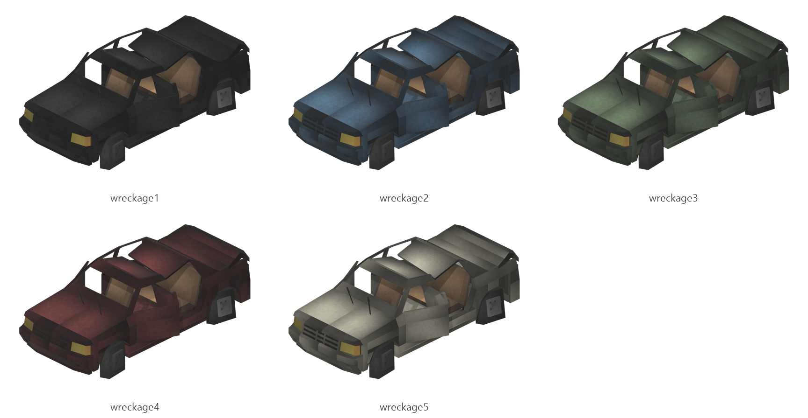

# Wreckage

Board ticket `t146` | category `block` | 5 variants

## Variants to replace

- `wreckage1`
- `wreckage2`
- `wreckage3`
- `wreckage4`
- `wreckage5`

Each variant in `old/` has its own `models/` and `textures/`. Deliver one replacement per variant in `new/`, using the same variant names unless agreed otherwise.

## Where the old asset lives in the mod

- `content/block/decimation/wreckage1`
- `content/block/decimation/wreckage2`
- `content/block/decimation/wreckage3`
- `content/block/decimation/wreckage4`
- `content/block/decimation/wreckage5`

## Status

Not started