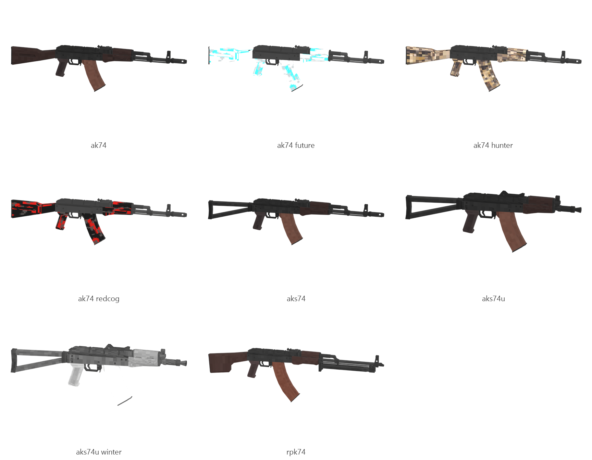

# AK-74 family (AK-74, AKS-74, AKS-74U, RPK-74)

Board ticket `g02` | category `gun/rifle` | 4 variants

## Variants to replace

- `ak74`
- `aks74`
- `aks74u`
- `rpk74`

Each variant in `old/` has its own `models/` and `textures/`. Deliver one replacement per variant in `new/`, using the same variant names unless agreed otherwise.

## Animations (reference only)

- `ak74`: fire, rack, reload1, slide_back
- `aks74`: fire, rack, reload1, slide_back
- `aks74u`: fire, rack, reload1, slide_back
- `rpk74`: fire, rack, reload1, slide_back

The mod's weapon and animation pipeline is being replaced, so the new gun does not need to fit these. Agree the delivery format with the owner (see CONTRIBUTING.md).

## Where the old asset lives in the mod

- `content/gun/rifle/ak74`
- `content/gun/rifle/aks74`
- `content/gun/rifle/aks74u`
- `content/gun/rifle/rpk74`

## Status

Not started