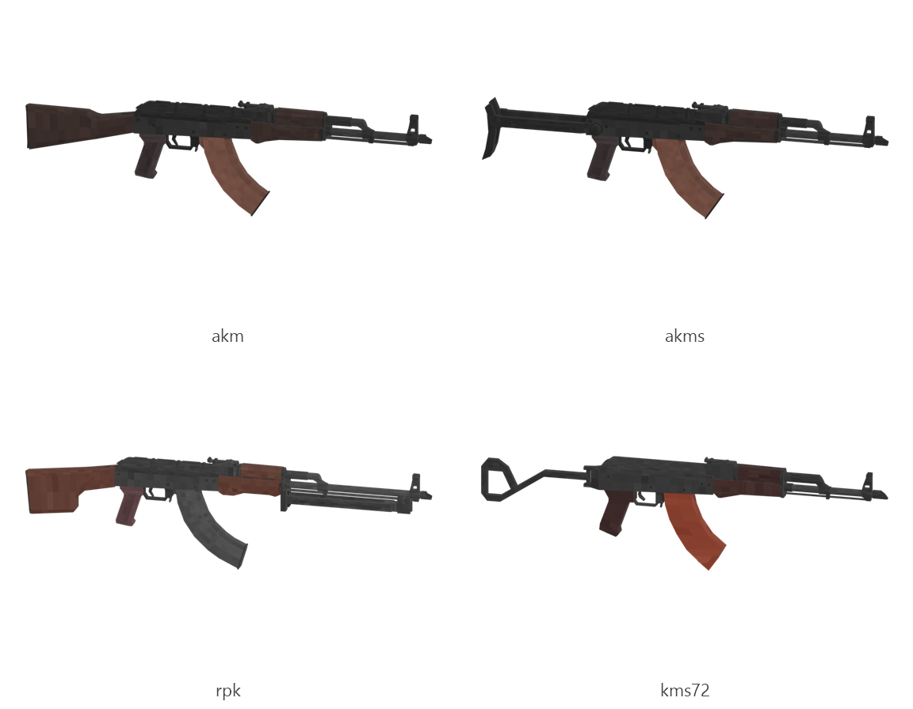

# AKM family (AKM, AKMS, RPK, KMS-72)

Board ticket `g03` | category `gun/rifle` | 4 variants

## Variants to replace

- `akm`
- `akms`
- `rpk`
- `kms72`

Each variant in `old/` has its own `models/` and `textures/`. Deliver one replacement per variant in `new/`, using the same variant names unless agreed otherwise.

## Animations (reference only)

- `akm`: fire, rack, reload1, slide_back
- `akms`: fire, rack, reload1, slide_back
- `rpk`: fire, rack, reload1, slide_back
- `kms72`: fire, rack, reload1, slide_back

The mod's weapon and animation pipeline is being replaced, so the new gun does not need to fit these. Agree the delivery format with the owner (see CONTRIBUTING.md).

## Where the old asset lives in the mod

- `content/gun/rifle/akm`
- `content/gun/rifle/akms`
- `content/gun/rifle/rpk`
- `content/gun/rifle/kms72`

## Status

Not started