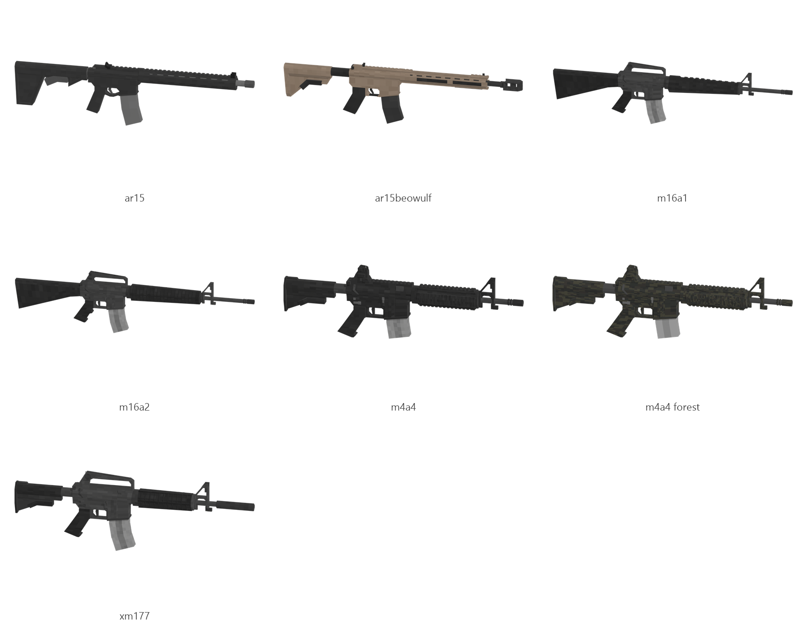

# AR-15 / M16 family (AR-15, Beowulf, M16A1, M16A2, M4A4, XM177)

Board ticket `g04` | category `gun/rifle` | 6 variants

## Variants to replace

- `ar15`
- `ar15beowulf`
- `m16a1`
- `m16a2`
- `m4a4`
- `xm177`

Each variant in `old/` has its own `models/` and `textures/`. Deliver one replacement per variant in `new/`, using the same variant names unless agreed otherwise.

## Animations (reference only)

- `ar15`: fire, rack, reload1, slide_back
- `ar15beowulf`: fire, rack, reload1, slide_back
- `m16a1`: fire, rack, reload1, slide_back
- `m16a2`: fire, rack, reload1, slide_back
- `m4a4`: fire, rack, reload1, slide_back
- `xm177`: fire, rack, reload1, slide_back

The mod's weapon and animation pipeline is being replaced, so the new gun does not need to fit these. Agree the delivery format with the owner (see CONTRIBUTING.md).

## Where the old asset lives in the mod

- `content/gun/rifle/ar15`
- `content/gun/rifle/ar15beowulf`
- `content/gun/rifle/m16a1`
- `content/gun/rifle/m16a2`
- `content/gun/rifle/m4a4`
- `content/gun/rifle/xm177`

## Status

Not started