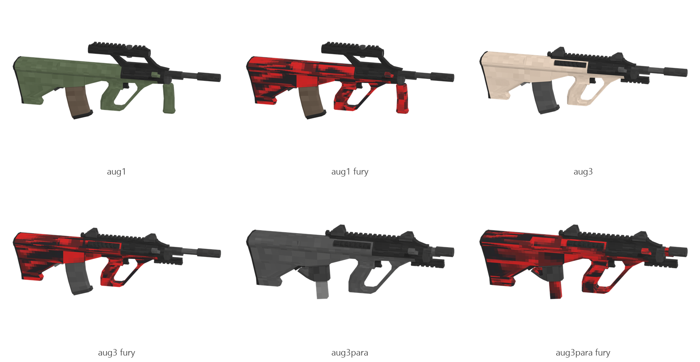

# AUG (A1, A3, A3 Para)

Board ticket `g05` | category `gun/rifle` | 3 variants

## Variants to replace

- `aug1`
- `aug3`
- `aug3para`

Each variant in `old/` has its own `models/` and `textures/`. Deliver one replacement per variant in `new/`, using the same variant names unless agreed otherwise.

## Animations (reference only)

- `aug1`: fire, rack, reload1, slide_back
- `aug3`: fire, rack, reload1, slide_back
- `aug3para`: fire, rack, reload1, slide_back

The mod's weapon and animation pipeline is being replaced, so the new gun does not need to fit these. Agree the delivery format with the owner (see CONTRIBUTING.md).

## Where the old asset lives in the mod

- `content/gun/rifle/aug1`
- `content/gun/rifle/aug3`
- `content/gun/rifle/aug3para`

## Status

Not started