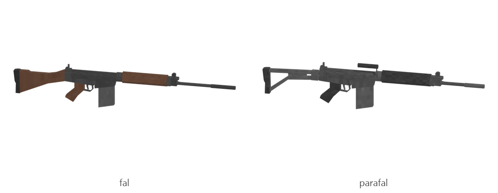

# FAL / ParaFAL

Board ticket `g06` | category `gun/rifle` | 2 variants

## Variants to replace

- `fal`
- `parafal`

Each variant in `old/` has its own `models/` and `textures/`. Deliver one replacement per variant in `new/`, using the same variant names unless agreed otherwise.

## Animations (reference only)

- `fal`: fire, rack, reload1, slide_back
- `parafal`: fire, rack, reload1, slide_back

The mod's weapon and animation pipeline is being replaced, so the new gun does not need to fit these. Agree the delivery format with the owner (see CONTRIBUTING.md).

## Where the old asset lives in the mod

- `content/gun/rifle/fal`
- `content/gun/rifle/parafal`

## Status

Not started