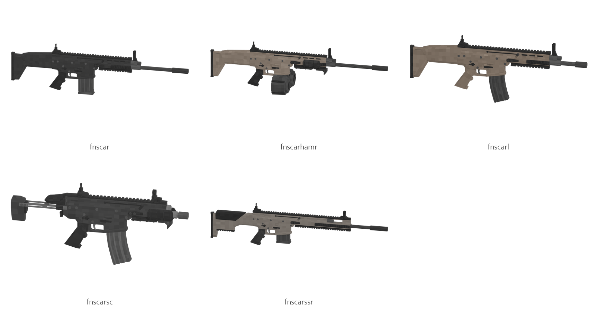

# FN SCAR (SCAR, HAMR, L, SC, SSR)

Board ticket `g08` | category `gun/rifle` | 5 variants

## Variants to replace

- `fnscar`
- `fnscarhamr`
- `fnscarl`
- `fnscarsc`
- `fnscarssr`

Each variant in `old/` has its own `models/` and `textures/`. Deliver one replacement per variant in `new/`, using the same variant names unless agreed otherwise.

## Animations (reference only)

- `fnscar`: fire, rack, reload1, slide_back
- `fnscarhamr`: fire, rack, reload1, slide_back
- `fnscarl`: fire, rack, reload1, slide_back
- `fnscarsc`: fire, rack, reload1, slide_back
- `fnscarssr`: fire, rack, reload1, slide_back

The mod's weapon and animation pipeline is being replaced, so the new gun does not need to fit these. Agree the delivery format with the owner (see CONTRIBUTING.md).

## Where the old asset lives in the mod

- `content/gun/rifle/fnscar`
- `content/gun/rifle/fnscarhamr`
- `content/gun/rifle/fnscarl`
- `content/gun/rifle/fnscarsc`
- `content/gun/rifle/fnscarssr`

## Status

Not started