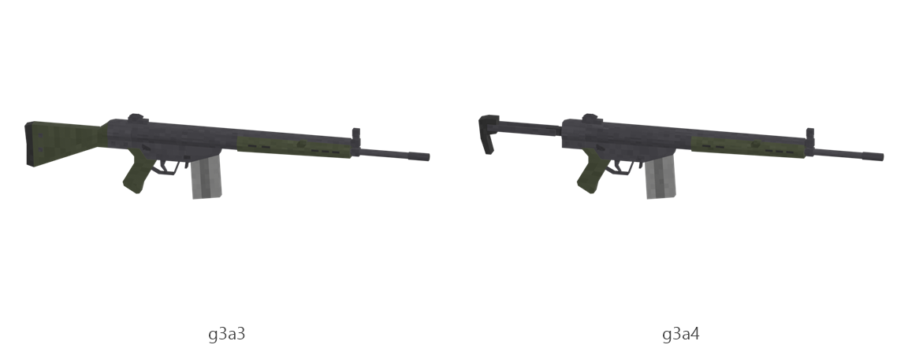

# G3 (G3A3, G3A4)

Board ticket `g09` | category `gun/rifle` | 2 variants

## Variants to replace

- `g3a3`
- `g3a4`

Each variant in `old/` has its own `models/` and `textures/`. Deliver one replacement per variant in `new/`, using the same variant names unless agreed otherwise.

## Animations (reference only)

- `g3a3`: fire, rack, reload1, slide_back
- `g3a4`: fire, rack, reload1, slide_back

The mod's weapon and animation pipeline is being replaced, so the new gun does not need to fit these. Agree the delivery format with the owner (see CONTRIBUTING.md).

## Where the old asset lives in the mod

- `content/gun/rifle/g3a3`
- `content/gun/rifle/g3a4`

## Status

Not started