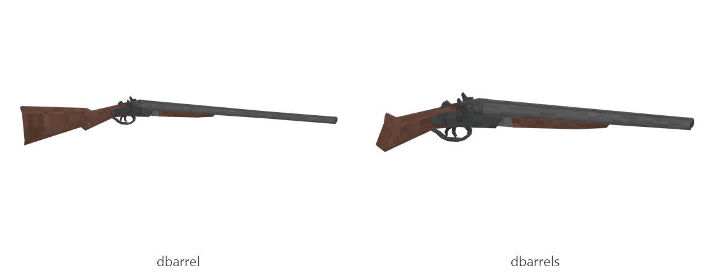

# Double barrel (full, sawn-off)

Board ticket `g11` | category `gun/shotgun` | 2 variants

## Variants to replace

- `dbarrel`
- `dbarrels`

Each variant in `old/` has its own `models/` and `textures/`. Deliver one replacement per variant in `new/`, using the same variant names unless agreed otherwise.

## Animations (reference only)

- `dbarrel`: fire, rack, reload1
- `dbarrels`: fire, rack, reload1

The mod's weapon and animation pipeline is being replaced, so the new gun does not need to fit these. Agree the delivery format with the owner (see CONTRIBUTING.md).

## Where the old asset lives in the mod

- `content/gun/shotgun/dbarrel`
- `content/gun/shotgun/dbarrels`

## Status

Not started