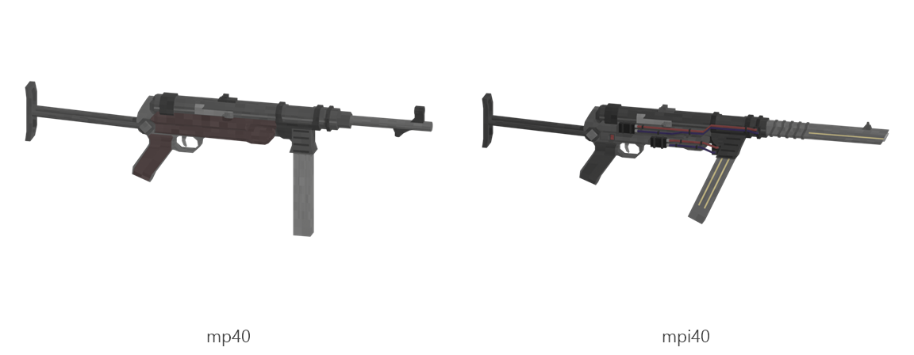

# MP 40 / MPi 40

Board ticket `g12` | category `gun/smg` | 2 variants

## Variants to replace

- `mp40`
- `mpi40`

Each variant in `old/` has its own `models/` and `textures/`. Deliver one replacement per variant in `new/`, using the same variant names unless agreed otherwise.

## Animations (reference only)

- `mp40`: fire, rack, reload1, slide_back
- `mpi40`: fire, rack, reload1, slide_back

The mod's weapon and animation pipeline is being replaced, so the new gun does not need to fit these. Agree the delivery format with the owner (see CONTRIBUTING.md).

## Where the old asset lives in the mod

- `content/gun/smg/mp40`
- `content/gun/smg/mpi40`

## Status

Not started