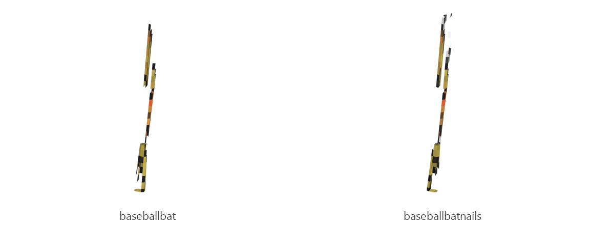

# Baseball bat

Board ticket `t043` | category `item` | 2 variants

## Variants to replace

- `baseballbat`
- `baseballbatnails`

Each variant in `old/` has its own `models/` and `textures/`. Deliver one replacement per variant in `new/`, using the same variant names unless agreed otherwise.

## Where the old asset lives in the mod

- `content/item/baseballbat`
- `content/item/baseballbatnails`

## Status

Not started