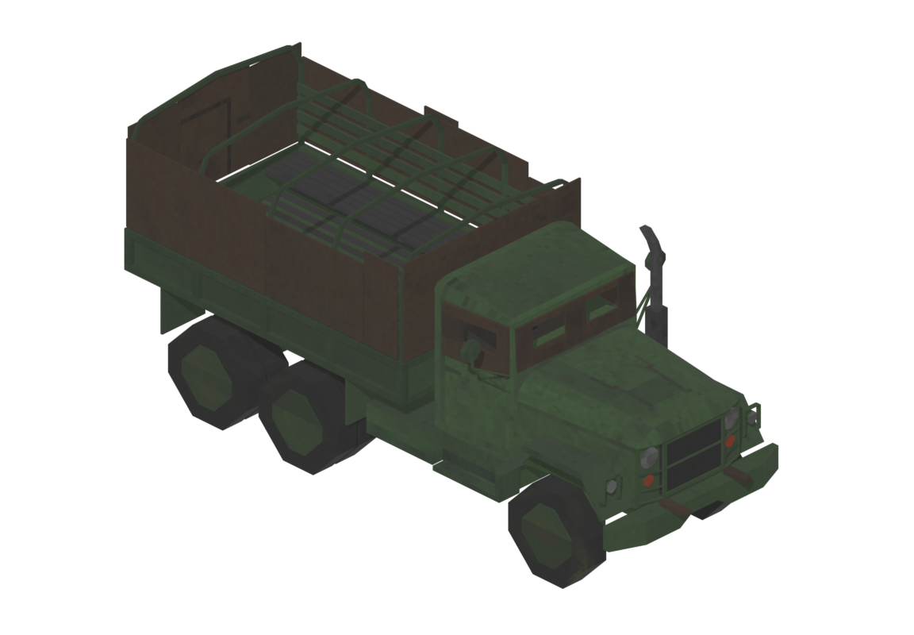

# M35 truck

Board ticket `t064` | category `vehicle` | 1 variant

## Variants to replace

- `m35`

Each variant in `old/` has its own `models/` and `textures/`. Deliver one replacement per variant in `new/`, using the same variant names unless agreed otherwise.

## Where the old asset lives in the mod

- `content/vehicle/m35`

## Status

Not started